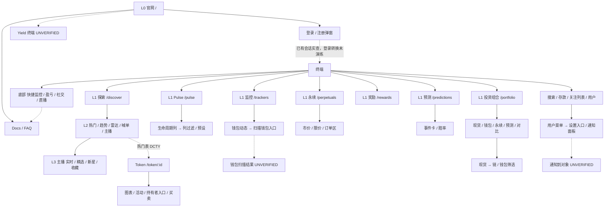
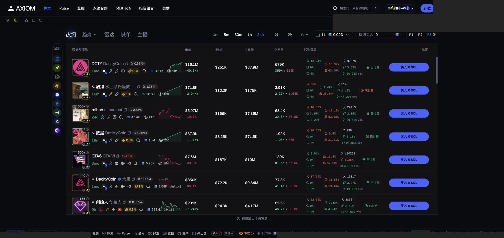

# Axiom · Desktop Web 产品架构

本页保留原始采样口径。用户提供会话后的新增实测见[五家登录后补验](07-visitor-and-signed-in-coverage.md#登录后补验)。

2026-11-19（曼谷时间）。已有登录会话的终端顶部有 7 个一级入口。游客入口是独立官网。

OBS 为本轮实查的页面或入口，DOC 为官方资料，INFER 为基于实查的判断，UNVERIFIED 为未实查的页面、交互或身份。截图中的账户数据已遮盖。

## A. 产品架构树

```text
Axiom
├── 官网 /
│   ├── Features / Execution / Rewards / FAQ
│   ├── 登录 / 注册
│   └── Docs
└── 交易终端
    ├── 探索
    │   ├── 热门 → 代币详情 → 图表、活动、持有者、买卖
    │   ├── 趋势
    │   ├── 雷达
    │   ├── 喊单
    │   └── 主播 → 首页、实时、精选、新星、收藏、全部
    ├── Pulse
    │   └── 生命周期三栏 → 列过滤、钱包组、预设
    ├── 监控
    │   └── 钱包 → 实时交易设置、动态筛选、扫描钱包入口
    ├── 永续合约
    │   └── 图表、盘口、市价、限价、仓位
    ├── 预测市场
    │   └── 事件筛选、事件卡、赔率走势
    ├── 投资组合
    │   ├── 现货 → 链筛选、钱包筛选
    │   └── 钱包、永续、预测、对比
    ├── 奖励
    ├── 顶部工具
    │   └── 搜索、选链、存款、关注列表、钱包选择、用户菜单
    │       └── 用户菜单 → 设置入口、通知、退出登录
    └── 底部状态栏
        └── 钱包、社交、探索、Pulse、盈亏、好友、直播、喊单、弹出窗、文档
```

## B. Sitemap

[Mermaid 源文件](sitemaps/01-axiom.mmd)。实线为导航或页内层级，虚线为上下文跳转或访问边界。未验证目的地在图中明确标注。



## C. 导航分析

| 导航位置 | 功能入口 | 所属模块 | 页面层级 | 实际路径 |
| --- | --- | --- | --- | --- |
| 顶部 | 官网 | 官网 | L0 | 游客 → Start trading → 弹窗。跟随官网 /discover 链接后回到 / · [A01](screenshots/a01.jpg) [A18](screenshots/a18.jpg) |
| 顶部 | 探索 | 探索 | L1 | 终端 → 探索 → 热门 → DCTY · [A06](screenshots/a06.jpg) [A07](screenshots/a07.jpg) |
| 顶部 | Pulse | Pulse | L1 | 探索 → Pulse，原链范围仍在 URL · [A10](screenshots/a10.jpg) |
| 顶部 | 监控 | 监控 | L1 | 顶部监控 → 钱包。扫描目标面板未验证 · [A11](screenshots/a11.jpg) |
| 顶部 | 永续合约 | 永续合约 | L1 | 顶部永续合约 → 下单面板 · [A12](screenshots/a12.jpg) |
| 顶部 | 预测市场 | 预测市场 | L1 | 顶部预测市场 → 事件卡可见 · [A13](screenshots/a13.jpg) |
| 顶部 | 投资组合 | 投资组合 | L1 | 顶部投资组合 → 现货默认视图。钱包子页操作未验证 · [A14](screenshots/a14.jpg) |
| 顶部 | 奖励 | 奖励 | L1 | 终端奖励入口与官网 Rewards 介绍分别存在 · [A05](screenshots/a05.jpg) [A01](screenshots/a01.jpg) |
| 上下文 | 代币详情 | 对象详情 | L2–L3 | 探索 → 热门 → 点击 DCTY → 同页详情。持有者控件被观察到，列表打开未确认 · [A07](screenshots/a07.jpg) [A08](screenshots/a08.jpg) |
| 顶部工具 | 账户与通知 | 账户与通知 | L2–L3 | 投资组合 → 用户 → 通知，未跟进消息跳转 · [A15](screenshots/a15.jpg) [A16](screenshots/a16.jpg) |
| 顶部工具和底部 | 快速栏与状态栏 | 快速栏与状态栏 | L2–L3 | 顶部搜索标代币或合约地址及 /。底部快捷入口与顶部路由存在功能重叠 · [A06](screenshots/a06.jpg) [A07](screenshots/a07.jpg) [A11](screenshots/a11.jpg) |
| 官网顶部及终端底部 | 帮助文档 | 帮助文档 | L1 | 官网顶部 Docs 或终端底部文档 · [A01](screenshots/a01.jpg) [A17](screenshots/a17.jpg) |

## D. 页面清单

| 页面名称 | 所属模块 | 页面用途 | 主要内容 | 关联页面 |
| --- | --- | --- | --- | --- |
| 官网 · `/` | 顶部 | 对外介绍和认证 | Features、Execution、Rewards、FAQ 是官网页内分区，Docs 外跳，Start trading 打开认证 | 游客 → Start trading → 弹窗。跟随官网 /discover 链接后回到 / · OBS · [A01](screenshots/a01.jpg) [A18](screenshots/a18.jpg) |
| 探索 · `/discover` | 顶部 | 找币与获取市场信息 | 热门、趋势下拉、雷达、喊单、主播。主播下还有首页、实时、精选、新星、收藏和全部 | 终端 → 探索 → 热门 → DCTY · OBS · [A06](screenshots/a06.jpg) [A07](screenshots/a07.jpg) |
| Pulse · `/pulse` | 顶部 | 监控代币发行阶段 | 三栏生命周期，独立过滤，钱包组及预设 | 探索 → Pulse，原链范围仍在 URL · OBS · [A10](screenshots/a10.jpg) |
| 监控 · `/trackers` | 顶部 | 追踪钱包及交易动态 | 钱包视图、实时交易设置、按钱包筛动态、扫描钱包入口 | 顶部监控 → 钱包。扫描目标面板未验证 · OBS · [A11](screenshots/a11.jpg) |
| 永续合约 · `/perpetuals` | 顶部 | 衍生品交易 | 行情图、盘口、市价、限价及仓位区 | 顶部永续合约 → 下单面板 · OBS · [A12](screenshots/a12.jpg) |
| 预测市场 · `/predictions` | 顶部 | 浏览预测事件 | 事件筛选、事件卡和赔率走势 | 顶部预测市场 → 事件卡可见 · OBS · [A13](screenshots/a13.jpg) |
| 投资组合 · `/portfolio` | 顶部 | 管理个人资产及组合 | 现货、钱包、永续合约、预测市场、对比。现货下有多链选择、钱包选择和其他钱包搜索 | 顶部投资组合 → 现货默认视图。钱包子页操作未验证 · OBS · [A14](screenshots/a14.jpg) |
| 奖励 · `/rewards` | 顶部 | 查看账户奖励 | 已有会话进入奖励面板，个人数值已遮盖 | 终端奖励入口与官网 Rewards 介绍分别存在 · OBS · [A05](screenshots/a05.jpg) [A01](screenshots/a01.jpg) |
| 代币详情 · `/token/9hjBLBrc7WZW2H8UQvBAvG5WiTZotXUv2Bdcn4f4pump` | 上下文 | 研究和交易同一代币 | 图表、活动及持有者入口、买卖面板及钱包组 | 探索 → 热门 → 点击 DCTY → 同页详情。持有者控件被观察到，列表打开未确认 · OBS · [A07](screenshots/a07.jpg) [A08](screenshots/a08.jpg) |
| 账户与通知 · `同当前终端路由，样本 /portfolio` | 顶部工具 | 账户操作和消息 | 用户菜单显示设置、通知、退出登录。通知可打开并显示清除全部 | 投资组合 → 用户 → 通知，未跟进消息跳转 · OBS · [A15](screenshots/a15.jpg) [A16](screenshots/a16.jpg) |
| 快速栏与状态栏 · `终端内` | 顶部工具和底部 | 叠加快捷工作区 | 钱包监控、社交、探索、Pulse、盈亏、好友、直播、喊单及代币弹出窗。可见快速栏和状态栏设置 | 顶部搜索标代币或合约地址及 /。底部快捷入口与顶部路由存在功能重叠 · OBS · [A06](screenshots/a06.jpg) [A07](screenshots/a07.jpg) [A11](screenshots/a11.jpg) |
| 帮助文档 · `https://docs.axiom.trade/` | 官网顶部及终端底部 | 独立帮助中心 | 左侧分类和搜索，含交易、Portfolio、多钱包、钱包监控、Trader Scan 和 Support | 官网顶部 Docs 或终端底部文档 · OBS · [A01](screenshots/a01.jpg) [A17](screenshots/a17.jpg) |

## E. 产品架构分析

顶部按工作台和交易品类分流，底栏保留高频工具。热门、趋势、雷达、喊单、主播作为探索内部视图，减少一级扩张。终端顶部跨多个路由可见，本轮没有进行滚动固定测试。切到 Pulse 时多链参数仍在 URL，列表滚动、筛选及返回恢复未验证。左侧出现链选择等页面控件，抽样未见全站一级侧栏。
从本轮抽样看，详情与 Pulse 的信息密度最高（INFER）。榜单、图表、快捷买卖串联明确，但探索与 Pulse 的分工、底栏与顶部同名入口、钱包选择与交易预设需要学习。可借鉴按任务分层和在 Token 详情内完成买卖准备。LogEarn 暂不需要复刻探索、社交、直播和预设并排的全套快捷栏。 [a06–a12]
独立 AI 策略页未验证。官网展示 Yield 入口，已有会话的顶部未出现，实际终端权限与路由未验证。钱包扫描、Token 持有者到钱包、建立追踪、通知到对象、喊单到交易者均未走通。文档索引显示 Adding Wallets 和 Trader Scan（DOC），只作为复测线索。

## F. 身份与权限

游客看到官网和认证。已有登录会话由用户浏览器提供，注册步骤、注册类型、外部钱包连接、免费或付费身份均未确认。无法把官网与登录终端的差异归因到套餐。

## G. 证据读图

- Axiom · 官网 · `/` · OBS。游客 → Start trading → 弹窗。跟随官网 /discover 链接后回到 /。[A01](screenshots/a01.jpg) [A18](screenshots/a18.jpg)
- Axiom · 探索 · `/discover` · OBS。终端 → 探索 → 热门 → DCTY。[A06](screenshots/a06.jpg) [A07](screenshots/a07.jpg)
- Axiom · Pulse · `/pulse` · OBS。探索 → Pulse，原链范围仍在 URL。[A10](screenshots/a10.jpg)
- Axiom · 监控 · `/trackers` · OBS。顶部监控 → 钱包。扫描目标面板未验证。[A11](screenshots/a11.jpg)
- Axiom · 永续合约 · `/perpetuals` · OBS。顶部永续合约 → 下单面板。[A12](screenshots/a12.jpg)
- Axiom · 预测市场 · `/predictions` · OBS。顶部预测市场 → 事件卡可见。[A13](screenshots/a13.jpg)
- Axiom · 投资组合 · `/portfolio` · OBS。顶部投资组合 → 现货默认视图。钱包子页操作未验证。[A14](screenshots/a14.jpg)
- Axiom · 奖励 · `/rewards` · OBS。终端奖励入口与官网 Rewards 介绍分别存在。[A05](screenshots/a05.jpg) [A01](screenshots/a01.jpg)
- Axiom · 代币详情 · `/token/9hjBLBrc7WZW2H8UQvBAvG5WiTZotXUv2Bdcn4f4pump` · OBS。探索 → 热门 → 点击 DCTY → 同页详情。持有者控件被观察到，列表打开未确认。[A07](screenshots/a07.jpg) [A08](screenshots/a08.jpg)
- Axiom · 账户与通知 · `同当前终端路由，样本 /portfolio` · OBS。投资组合 → 用户 → 通知，未跟进消息跳转。[A15](screenshots/a15.jpg) [A16](screenshots/a16.jpg)
- Axiom · 快速栏与状态栏 · `终端内` · OBS。顶部搜索标代币或合约地址及 /。底部快捷入口与顶部路由存在功能重叠。[A06](screenshots/a06.jpg) [A07](screenshots/a07.jpg) [A11](screenshots/a11.jpg)
- Axiom · 帮助文档 · `https://docs.axiom.trade/` · OBS。官网顶部 Docs 或终端底部文档。[A01](screenshots/a01.jpg) [A17](screenshots/a17.jpg)


