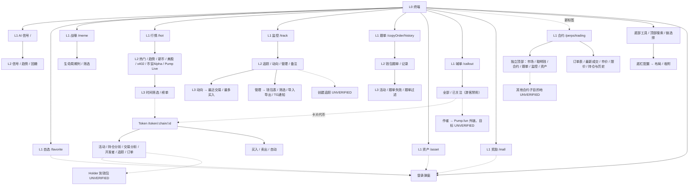
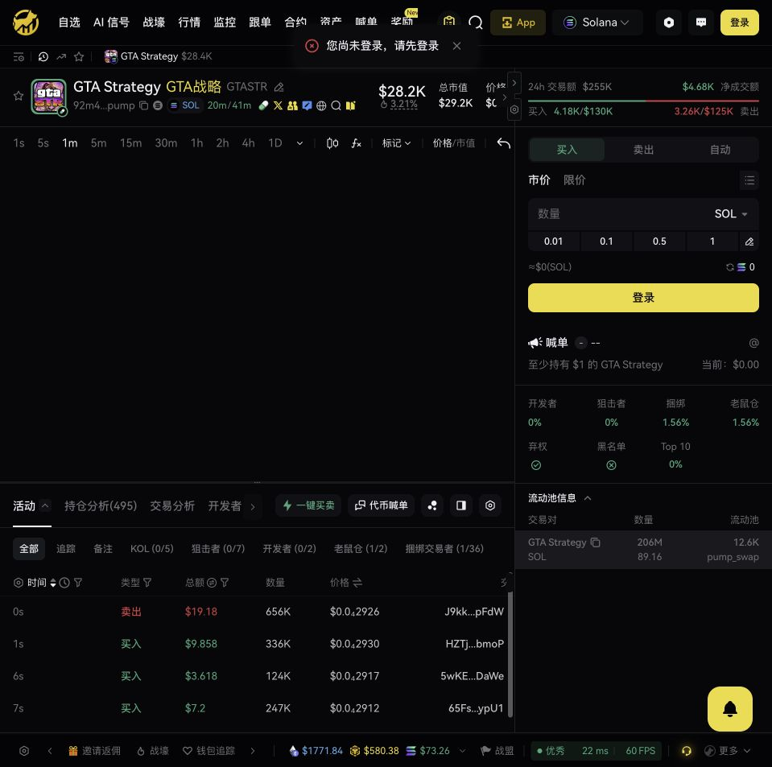

# DeBot · Desktop Web 产品架构

本页保留原始采样口径。用户提供会话后的新增实测见[五家登录后补验](07-visitor-and-signed-in-coverage.md#登录后补验)。

2026-11-19（曼谷时间）。游客终端顶部 10 个标签。根路由默认选中 AI 信号。

OBS 为实访页面或交互，DOC 为官方资料，INFER 为分析判断，UNVERIFIED 为未验证。本轮样本为 Solana 游客。

## A. 产品架构树

```text
DeBot
├── AI 信号
│   ├── 信号
│   ├── 趋势
│   ├── 回撤筛选
├── 自选
├── 战壕
├── 行情
│   ├── 热门
│   │   └── 时间筛选；趋势
│   ├── 新币
│   ├── 美股
│   ├── x402
│   ├── 币安Alpha
│   ├── Pump Live
├── 监控
│   ├── 追踪
│   ├── 动向
│   │   └── 最近交易、最多买入；管理
│   ├── 备注
├── 跟单
│   ├── 钱包跟单
│   ├── 跟单记录
│   │   └── 活动、失败、过滤
├── 合约（新标签，独立导航）
│   ├── 市场 / 聪明钱 / 合约 / 跟单 / 监控 / 资产
│   └── 合约 → 图表、订单表、最新成交、市价/限价、持仓与历史
├── 资产
├── 喊单
├── 奖励
├── 代币详情
│   ├── 活动
│   ├── 持仓分析（登录）
│   ├── 交易分析
│   ├── 开发者
│   ├── 追踪
│   ├── 我的持仓
│   ├── 订单
├── 搜索与底部工具
└── 登录及帮助线索
```

## B. Sitemap

[Mermaid 源文件](sitemaps/02-debot.mmd)。实线为导航或页内层级，虚线为上下文，点线指向的未验证目的地以文字标注。



## C. 导航分析

| 导航位置 | 功能入口 | 所属模块 | 页面层级 | 实际路径 |
| --- | --- | --- | --- | --- |
| 顶部 | AI 信号 | AI 信号 | L1 | 首页直达。公告写未登录数据延迟 1 小时，实际延时未独立测量 · [D01](screenshots/d01.jpg) |
| 顶部 | 自选 | 自选 | L1 | 顶部自选 → 登录提示 · [D14](screenshots/d14.jpg) |
| 顶部 | 战壕 | 战壕 | L1 | 顶部战壕 → 战壕工作区 · [D08](screenshots/d08.jpg) |
| 顶部 | 行情 | 行情 | L1 | AI 信号 → 行情 → 榜单 Token 链接。通过链接读取地址访问详情 · [D02](screenshots/d02.jpg) [D04](screenshots/d04.jpg) |
| 顶部 | 监控 | 监控 | L1 | 顶部监控 → 动向 · [D07](screenshots/d07.jpg) |
| 顶部 | 跟单 | 跟单 | L1 | 顶部跟单落在历史。创建任务未验证 · [D10](screenshots/d10.jpg) |
| 顶部 | 合约 | 合约 | L1 | 顶部合约 → 新标签打开永续工作台 · [D20](screenshots/d20.jpg) [D21](screenshots/d21.jpg) |
| 顶部 | 资产 | 资产 | L1 | 顶部资产 → 登录提示 · [D16](screenshots/d16.jpg) |
| 顶部 | 喊单 | 喊单 | L1 | 顶部喊单 → 全部 → 卡片代币 → Token 详情。抽样作者链接指向 Pump.fun · [D23](screenshots/d23.jpg) |
| 顶部 | 奖励 | 奖励 | L1 | 顶部奖励 → 登录提示 · [D18](screenshots/d18.jpg) |
| 上下文 | 代币详情 | 对象详情 | L2–L3 | 行情榜单 → GTA Strategy。点击持仓分析后出现登录提示 · [D04](screenshots/d04.jpg) [D05](screenshots/d05.jpg) |
| 顶部工具和底部 | 搜索与底部工具 | 搜索与底部工具 | L2–L3 | 市场与详情均保留部分工具。搜索弹层可输入 Token 或钱包；结果、通知中心与布局保存未验证 · [D01](screenshots/d01.jpg) [D04](screenshots/d04.jpg) [D07](screenshots/d07.jpg) [D19](screenshots/d19.jpg) |
| 顶部工具及上下文 | 登录及帮助线索 | 登录及帮助线索 | L2–L3 | 奖励或顶部登录 → 认证。帮助首页未验证 · [D19](screenshots/d19.jpg) |

## D. 页面清单

| 页面名称 | 所属模块 | 页面用途 | 主要内容 | 关联页面 |
| --- | --- | --- | --- | --- |
| AI 信号 · `/` | 顶部 | 默认机会看板 | 信号、趋势、回撤筛选入口，24h 热度及卡片。游客延时公告 | 首页直达。公告写未登录数据延迟 1 小时，实际延时未独立测量 · OBS · [D01](screenshots/d01.jpg) |
| 自选 · `/favorite?chain=solana` | 顶部 | 查看收藏 | 时间筛选可见，个人列表须登录 | 顶部自选 → 登录提示 · OBS · [D14](screenshots/d14.jpg) |
| 战壕 · `/meme?chain=solana` | 顶部 | 发现新代币 | 多列生命周期卡片。Logo 也指向 /meme | 顶部战壕 → 战壕工作区 · OBS · [D08](screenshots/d08.jpg) |
| 行情 · `/hot?chain=solana` | 顶部 | 多个维度筛选市场 | 热门、趋势、新币、美股、x402、币安Alpha、Pump Live。热门下有分钟至天时间筛选 | AI 信号 → 行情 → 榜单 Token 链接。通过链接读取地址访问详情 · OBS · [D02](screenshots/d02.jpg) [D04](screenshots/d04.jpg) |
| 监控 · `/track?chain=solana` | 顶部 | 看钱包交易流水及维护跟踪 | 追踪、动向、管理、备注。动向下有时间筛选、最近交易与最多买入 | 顶部监控 → 动向 · OBS · [D07](screenshots/d07.jpg) |
| 跟单 · `/copyOrder/history?chain=solana` | 顶部 | 管理复制交易任务与记录 | 钱包跟单和记录入口，记录下有活动、跟单失败、跟单过滤 | 顶部跟单落在历史。创建任务未验证 · OBS · [D10](screenshots/d10.jpg) |
| 合约 · `/perps/trading?chain=solana` | 顶部 | 独立交易入口 | 独立顶部六栏。当前页订单表、最新成交、做多/做空、市价/限价，底部持仓及历史 | 顶部合约 → 新标签打开永续工作台 · OBS · [D20](screenshots/d20.jpg) [D21](screenshots/d21.jpg) |
| 资产 · `/asset?chain=solana` | 顶部 | 个人资产 | 游客登录提示。钱包管理及持仓明细未验证 | 顶部资产 → 登录提示 · OBS · [D16](screenshots/d16.jpg) |
| 喊单 · `/callout?chain=solana` | 顶部 | 按动态看喊单 | 全部、只显示已关注。游客的已关注筛选禁用 | 顶部喊单 → 全部 → 卡片代币 → Token 详情。抽样作者链接指向 Pump.fun · OBS · [D23](screenshots/d23.jpg) |
| 奖励 · `/mall?chain=solana` | 顶部 | 奖励入口 | 游客登录提示 | 顶部奖励 → 登录提示 · OBS · [D18](screenshots/d18.jpg) |
| 代币详情 · `/token/solana/92m4S52bu3dZyqzPmPStu8Krz6JcpzHdsG4D5QBqpump` | 上下文 | Token 研究和交易 | 图表、活动、持仓分析、交易分析、开发者、开发者代币、追踪、我的持仓与订单。右侧买入、卖出、自动 | 行情榜单 → GTA Strategy。点击持仓分析后出现登录提示 · OBS · [D04](screenshots/d04.jpg) [D05](screenshots/d05.jpg) |
| 搜索与底部工具 · `终端内` | 顶部工具和底部 | 全局查找和快捷浮层 | 顶部搜索框及链切换。底部栏设置、钱包追踪、持仓、钱包动向、喊单、代币喊单 | 市场与详情均保留部分工具。搜索弹层可输入 Token 或钱包；结果、通知中心与布局保存未验证 · OBS · [D01](screenshots/d01.jpg) [D04](screenshots/d04.jpg) [D07](screenshots/d07.jpg) [D19](screenshots/d19.jpg) |
| 登录及帮助线索 · `终端内，样本 /mall` | 顶部工具及上下文 | 打开认证 | 登录弹窗含通行密钥入口，条款和隐私链接到 docs.debot.ai | 奖励或顶部登录 → 认证。帮助首页未验证 · OBS · [D19](screenshots/d19.jpg) |

## E. 产品架构分析

DeBot 从 AI 信号启动，战壕负责生命周期扫描，行情则按市场维度切换。同一终端的头部在榜单、Token 和监控保留。Solana 在抽样导航继续作为 URL 参数。顶部主导航没有观察到左侧对应树。底部栏设置实查有布局与吸附页签，布局页显示拖动排序、隐藏、重置及完整/图标显示选项。保存后跨页与跨设备表现未测试。 [D26](screenshots/d26.jpg) · [D27](screenshots/d27.jpg)
一级入口措辞直接，但信号、行情、战壕都能作为找币起点。默认 AI 信号与 Logo 去战壕形成两个起点。行情二级把时效榜单、主题和外部平台内容放在一起，扫描较快，关系仍依赖使用经验。Token 详情把活动、持仓与操作聚合；游客确实能打开详情，但持仓分析遇到认证。可借鉴把实时权限提示放在数据附近，以及对跟单失败设置独立记录筛选。尽量避免将主题、生命周期与任务放在同一个二级维度。 [d01 d02 d04 d05 d10]
监控创建、钱包详情、持有人到钱包、通知到对象、账户设置页、应用级返回和上下文恢复均未验证。可见自动交易页签不足以证明独立策略工作台。

## F. 实走路径与权限

| 路径 | 实际结果 | 证据 |
| --- | --- | --- |
| AI 信号页 → 顶部合约 | 原标签保留，新标签进入永续工作台，顶部变为市场、聪明钱、合约、跟单、监控、资产。只实查了合约默认页 | [D20](screenshots/d20.jpg) · [D21](screenshots/d21.jpg) |
| 监控 → 管理 | `/track?chain=solana&tab=manager`。可见按链、名称或地址筛选，以及导入导出、TG 通知和声音、弹窗、实时提醒列。游客样本为空表，创建追踪未验证 | [D22](screenshots/d22.jpg) |
| 喊单 → 全部 → 卡片代币 | 实际进入 `/token/solana/pumpCmXqMfrsAkQ5r49WcJnRayYRqmXz6ae8H7H9Dfn`。抽样作者链接到 Pump.fun 资料页，目标未打开 | [D17](screenshots/d17.jpg) · [D23](screenshots/d23.jpg) · [D25](screenshots/d25.jpg) |
| 代币详情 → 底部栏设置 → 布局 / 吸附 | 能打开配置面板，并看到可隐藏模块和拖动排序说明 | [D26](screenshots/d26.jpg) · [D27](screenshots/d27.jpg) |
| 顶部搜索 → 输入 GTASTR | 弹层提供代币/钱包搜索和快买设置，未确认本次查询结果 | [D24](screenshots/d24.jpg) |


游客可看 AI 信号、行情、战壕和喊单。资产、自选、奖励及 Token 持仓分析会提示登录。注册、已连接钱包、免费与付费身份均未验证。

**对 LogEarn 的启发（INFER）**。可以借鉴可隐藏、可排序的快捷栏，以及把关注名单和提醒设置放在同一个监控管理页。DeBot 用新标签保留原看板，但合约同时切换整套主导航。若 LogEarn 采用独立工作台，应标明新标签和回到现货看板的入口。 [D20](screenshots/d20.jpg) · [D21](screenshots/d21.jpg) · [D22](screenshots/d22.jpg) · [D27](screenshots/d27.jpg)

## G. 证据读图

- DeBot · AI 信号 · `/` · OBS。首页直达。公告写未登录数据延迟 1 小时，实际延时未独立测量。[D01](screenshots/d01.jpg)
- DeBot · 自选 · `/favorite?chain=solana` · OBS。顶部自选 → 登录提示。[D14](screenshots/d14.jpg)
- DeBot · 战壕 · `/meme?chain=solana` · OBS。顶部战壕 → 战壕工作区。[D08](screenshots/d08.jpg)
- DeBot · 行情 · `/hot?chain=solana` · OBS。AI 信号 → 行情 → 榜单 Token 链接。通过链接读取地址访问详情。[D02](screenshots/d02.jpg) [D04](screenshots/d04.jpg)
- DeBot · 监控 · `/track?chain=solana` · OBS。顶部监控 → 动向。[D07](screenshots/d07.jpg)
- DeBot · 跟单 · `/copyOrder/history?chain=solana` · OBS。顶部跟单落在历史。创建任务未验证。[D10](screenshots/d10.jpg)
- DeBot · 合约 · `/perps/trading?chain=solana` · OBS。顶部合约 → 新标签打开永续工作台。[D20](screenshots/d20.jpg) [D21](screenshots/d21.jpg)
- DeBot · 资产 · `/asset?chain=solana` · OBS。顶部资产 → 登录提示。[D16](screenshots/d16.jpg)
- DeBot · 喊单 · `/callout?chain=solana` · OBS。顶部喊单 → 全部 → 卡片代币 → Token 详情。抽样作者链接指向 Pump.fun。[D23](screenshots/d23.jpg)
- DeBot · 奖励 · `/mall?chain=solana` · OBS。顶部奖励 → 登录提示。[D18](screenshots/d18.jpg)
- DeBot · 代币详情 · `/token/solana/92m4S52bu3dZyqzPmPStu8Krz6JcpzHdsG4D5QBqpump` · OBS。行情榜单 → GTA Strategy。点击持仓分析后出现登录提示。[D04](screenshots/d04.jpg) [D05](screenshots/d05.jpg)
- DeBot · 搜索与底部工具 · `终端内` · OBS。市场与详情均保留部分工具。搜索弹层可输入 Token 或钱包；结果、通知中心与布局保存未验证。[D01](screenshots/d01.jpg) [D04](screenshots/d04.jpg) [D07](screenshots/d07.jpg) [D19](screenshots/d19.jpg)
- DeBot · 登录及帮助线索 · `终端内，样本 /mall` · OBS。奖励或顶部登录 → 认证。帮助首页未验证。[D19](screenshots/d19.jpg)


