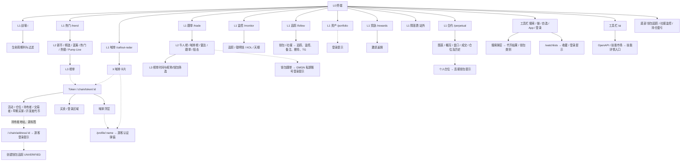
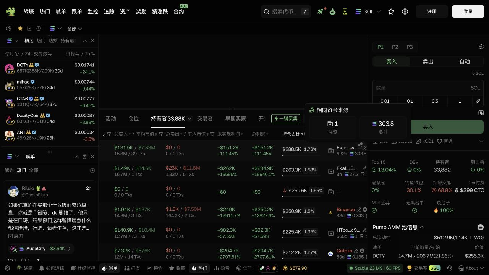

# GMGN · Desktop Web 产品架构

2026-11-19（曼谷时间）。主导航 10 个入口，其中 9 个站内目的地、1 个外部。AI 与自选另外位于全局工具区。

OBS 为实访页面与操作，DOC 为官方资料，INFER 为分析判断，UNVERIFIED 为未验证。本轮补查使用 BSC，原 SOL 样本仍保留链参数。

## A. 产品架构树

```text
GMGN
├── 战壕
├── 热门
│   ├── 新币
│   ├── 精选
│   ├── 蓝筹
│   ├── 热门
│   ├── 热搜
│   ├── Pump Live
│   │   └── Token
├── 喊单
├── 跟单
│   ├── 牛人榜
│   │   └── 时间、昵称或钱包；喊单榜
│   ├── 雷达
│   ├── 钱包跟单
│   ├── 天眼跟单
│   ├── 开发者狙击
│   ├── 代币狙击
│   ├── 推特刮刀
├── 监控
│   ├── 追踪
│   ├── 聪明钱
│   ├── KOL
│   ├── 天眼
├── 追踪
│   ├── 钱包
│   │   └── 追踪、监控、备注；社媒 > 推特、TG
├── 资产
├── 奖励
├── 猜涨跌
├── 合约
├── AI
│   ├── OpenAPI
│   ├── 技能市场
│   │   └── 技能详情入口
├── 代币详情
│   ├── 活动
│   ├── 仓位
│   ├── 持有者
│   │   └── 钱包
│   ├── 交易者
│   ├── 早期买家
│   ├── 开发者代币
├── 钱包详情
└── 全局工具与认证
```

## B. Sitemap

[Mermaid 源文件](sitemaps/03-gmgn.mmd)。实线为导航或页内层级，虚线为上下文，点线指向的未验证目的地以文字标注。



## C. 导航分析

| 导航位置 | 功能入口 | 所属模块 | 页面层级 | 实际路径 |
| --- | --- | --- | --- | --- |
| 顶部 | 战壕 | 战壕 | L1 | 直接进入主页。已补查 BSC 游客首页 · [G18](screenshots/g18.jpg) |
| 顶部 | 热门 | 热门 | L1 | 顶部热门 → 精选 → DCTY · [G06](screenshots/g06.jpg) [G07](screenshots/g07.jpg) |
| 顶部及上下文 | 喊单 | 喊单 | L1 | 顶部喊单 → X 喊单。样本卡片的代币成功打开详情，作者页触发登录 · [G19](screenshots/g19.jpg) [G25](screenshots/g25.jpg) [G26](screenshots/g26.jpg) |
| 顶部 | 跟单 | 跟单 | L1 | 顶部跟单 → 牛人榜 → 钱包跟单，页面要求登录 GMGN 私钥账号 · [G10](screenshots/g10.jpg) [G24](screenshots/g24.jpg) |
| 顶部 | 监控 | 监控 | L1 | 顶部监控 → 追踪 · [G11](screenshots/g11.jpg) |
| 顶部 | 追踪 | 追踪 | L1 | 顶部追踪 → 钱包和社媒分区，部分主体提示登录 · [G12](screenshots/g12.jpg) |
| 顶部 | 资产 | 资产 | L1 | 顶部资产 → 登录提示 · [G13](screenshots/g13.jpg) |
| 顶部 | 奖励 | 奖励 | L1 | 顶部奖励 → 邀请返佣 · [G14](screenshots/g14.jpg) |
| 顶部 | 猜涨跌 | 猜涨跌 | L1 | 顶部猜涨跌 · [G06](screenshots/g06.jpg) |
| 顶部 | 合约 | 合约 | L1 | 顶部合约 → BTC 永续路由 · [G20](screenshots/g20.jpg) |
| 顶部工具 | AI | AI | L2–L3 | 顶部工具区 → AI → 技能卡可见 · [G16](screenshots/g16.jpg) |
| 上下文 | 代币详情 | 对象详情 | L2–L3 | 热门 → DCTY → 持有者，地址在新标签打开 · [G03](screenshots/g03.jpg) [G07](screenshots/g07.jpg) [G08](screenshots/g08.jpg) |
| 上下文 | 钱包详情 | 对象详情 | L2–L3 | 持有者 → 地址 → 新标签登录提示 · [G07](screenshots/g07.jpg) [G08](screenshots/g08.jpg) |
| 顶部工具和底部 | 全局工具与认证 | 全局工具与认证 | L2–L3 | 顶部登录 → 弹窗。下方另有钱包追踪、社媒监控、持仓盈亏及交易赛 · [G06](screenshots/g06.jpg) [G12](screenshots/g12.jpg) [G17](screenshots/g17.jpg) |

## D. 页面清单

| 页面名称 | 所属模块 | 页面用途 | 主要内容 | 关联页面 |
| --- | --- | --- | --- | --- |
| 战壕 · `/?chain=sol` | 顶部 | 默认新币工作台 | 生命周期列、筛选器与局部快捷工具 | 直接进入主页。已补查 BSC 游客首页 · OBS · [G18](screenshots/g18.jpg) |
| 热门 · `/trend?chain=sol` | 顶部 | 代币榜单 | 新币、精选、蓝筹、热门、热搜、Pump Live。表格含市值、流动池、成交、持有人、快速买入 | 顶部热门 → 精选 → DCTY · OBS · [G06](screenshots/g06.jpg) [G07](screenshots/g07.jpg) |
| 喊单 · `/callout-radar?chain=sol` | 顶部及上下文 | 社交喊单入口 | 独立雷达显示 X 喊单及关联的代币和作者。Token 详情另有喊单浮层 | 顶部喊单 → X 喊单。样本卡片的代币成功打开详情，作者页触发登录 · OBS · [G19](screenshots/g19.jpg) [G25](screenshots/g25.jpg) [G26](screenshots/g26.jpg) |
| 跟单 · `/trade?chain=sol` | 顶部 | 从榜单找交易者并设置跟单 | 牛人榜、喊单榜、雷达、钱包跟单、天眼跟单、开发者狙击、代币狙击、推特刮刀。牛人榜可按时间和昵称或地址筛选 | 顶部跟单 → 牛人榜 → 钱包跟单，页面要求登录 GMGN 私钥账号 · OBS · [G10](screenshots/g10.jpg) [G24](screenshots/g24.jpg) |
| 监控 · `/monitor?chain=sol` | 顶部 | 看各类钱包装订阅和事件流 | 追踪、聪明钱、KOL、天眼。默认追踪区提示登录 | 顶部监控 → 追踪 · OBS · [G11](screenshots/g11.jpg) |
| 追踪 · `/follow?chain=sol` | 顶部 | 管理钱包及社媒对象 | 钱包、追踪、监控、备注；另有推特监控和 TG 监控及我的、精选、推荐筛选 | 顶部追踪 → 钱包和社媒分区，部分主体提示登录 · OBS · [G12](screenshots/g12.jpg) |
| 资产 · `/portfolio?chain=sol` | 顶部 | 个人资产 | 游客登录占位 | 顶部资产 → 登录提示 · OBS · [G13](screenshots/g13.jpg) |
| 奖励 · `/rewards?chain=sol` | 顶部 | 返佣 | 邀请返佣入口 | 顶部奖励 → 邀请返佣 · OBS · [G14](screenshots/g14.jpg) |
| 猜涨跌 · `https://future.news/updown` | 顶部 | 站外目的地 | 主导航外链可见，目标页未展开 | 顶部猜涨跌 · OBS · [G06](screenshots/g06.jpg) |
| 合约 · `/perpetual/BTC.PERP_USDC` | 顶部 | 永续入口 | 图表、概况、盘口、实时成交、仓位、委托、订单历史、资金费用与交易金。账户侧提示连接钱包 | 顶部合约 → BTC 永续路由 · OBS · [G20](screenshots/g20.jpg) |
| AI · `/ai` | 顶部工具 | 开发者能力与技能市场 | OpenAPI、技能市场及技能详情链接 | 顶部工具区 → AI → 技能卡可见 · OBS · [G16](screenshots/g16.jpg) |
| 代币详情 · `/sol/token/9hjBLBrc7WZW2H8UQvBAvG5WiTZotXUv2Bdcn4f4pump` | 上下文 | 对象分析、社交旁路和交易 | 活动、仓位、持有者、交易者、早期买家、开发者代币。右侧有登录及买卖区域。左侧可见榜单与喊单浮层入口 | 热门 → DCTY → 持有者，地址在新标签打开 · OBS · [G03](screenshots/g03.jpg) [G07](screenshots/g07.jpg) [G08](screenshots/g08.jpg) |
| 钱包详情 · `/sol/address/BDZnR7hLaU4GXJ4h2WYZG4qZ7Go9uRYsAmSStsmN6Fs2` | 上下文 | 通过 Token 持有人进入钱包 | 钱包目标路由已访问，样本显示尚未登录 | 持有者 → 地址 → 新标签登录提示 · OBS · [G07](screenshots/g07.jpg) [G08](screenshots/g08.jpg) |
| 全局工具与认证 · `终端内，样本 /ai` | 顶部工具和底部 | 搜索、链与账户 | 搜索占位明确包含代币名、合约和钱包，另有自选、链选择、App、注册登录。登录支持 Google、邮箱及扫码入口 | 顶部登录 → 弹窗。下方另有钱包追踪、社媒监控、持仓盈亏及交易赛 · OBS · [G06](screenshots/g06.jpg) [G12](screenshots/g12.jpg) [G17](screenshots/g17.jpg) |

## E. 产品架构分析

GMGN 把市场、社交、跟单、监控与追踪平铺，Token 页再组合活动、图表、持有人和交易。全局导航在榜单、Token、钱包和 AI 页保持可达。监控和追踪都使用追踪一词，跟单又含雷达和喊单榜，首次接触时容易把事件观察、对象管理和自动执行混在一起。左侧紧凑的榜单、喊单辅助面板保留研究入口，但增加同屏密度。
最清楚的跨对象样本是热门榜单 → DCTY → 持有者 → 钱包新标签。原 Token 标签仍在，游客在钱包页遇到认证。适合借鉴：单一搜索覆盖 Token 和钱包、详情以对象页签承载分析、钱包打开保留来源。应避免平铺语义相近的监控与追踪，或在多个一级入口中重复使用同一术语而缺乏副标题。 [g06 g07 g08 g10 g11 g12]
建立追踪、通知中心及深链、交易提交、账户设置、钱包管理、帮助中心、自定义布局和返回筛选恢复未验证。本轮实访喊单作者目标页并触发认证，作者主体仍未验证。

## F. 实走工作流与权限

| 路径 | 验证结果 | 证据 |
| --- | --- | --- |
| 热门 → DCTY → 持有者 → 钱包地址 | 钱包目标在新标签出现，游客看到登录提示 | [G07](screenshots/g07.jpg) · [G08](screenshots/g08.jpg) |
| 喊单 → X 喊单中的币种 → Token | BSC 卡片中的代币进入详情，显示活动、持有者等页签 | [G19](screenshots/g19.jpg) · [G26](screenshots/g26.jpg) |
| 喊单 → 作者链接 | 公开卡片给出 `/profile/wick1988`。实访该目标后出现认证弹窗 | [G19](screenshots/g19.jpg) · [G25](screenshots/g25.jpg) |
| 顶部搜索 → IRYS | 搜索弹层显示多个同名代币、发射平台筛选和钱包类别。钱包或 KOL 查询结果未测试 | [G23](screenshots/g23.jpg) |
| 顶部自选 → `/watchlists` → 收藏 | 游客可见收藏页签和登录提示 | [G21](screenshots/g21.jpg) |
| 跟单 → 钱包跟单 | 页面明确提示需登录 GMGN 私钥账号 | [G24](screenshots/g24.jpg) |
| 合约 → BTC 永续 | 公开图表、盘口和仓位区标签可见，查看个人未平仓仓位提示连接钱包 | [G20](screenshots/g20.jpg) |


游客可用榜单、Token 详情及持有者表，部分钱包、追踪及资产区要求登录。注册后、连接钱包、免费及付费权限均未验证。

**对 LogEarn 的启发（INFER）**。把代币、钱包与人物作为可互相跳转的对象，保留用户从哪里进入。监控、追踪和跟单可以按「看动态」「维护关注对象」「管理执行任务」来命名，降低三个入口的语义重叠。 [G07](screenshots/g07.jpg) · [G12](screenshots/g12.jpg) · [G24](screenshots/g24.jpg)

## G. 证据读图

- GMGN · 战壕 · `/?chain=sol` · OBS。直接进入主页。已补查 BSC 游客首页。[G18](screenshots/g18.jpg)
- GMGN · 热门 · `/trend?chain=sol` · OBS。顶部热门 → 精选 → DCTY。[G06](screenshots/g06.jpg) [G07](screenshots/g07.jpg)
- GMGN · 喊单 · `/callout-radar?chain=sol` · OBS。顶部喊单 → X 喊单。样本卡片的代币成功打开详情，作者页触发登录。[G19](screenshots/g19.jpg) [G25](screenshots/g25.jpg) [G26](screenshots/g26.jpg)
- GMGN · 跟单 · `/trade?chain=sol` · OBS。顶部跟单 → 牛人榜 → 钱包跟单，页面要求登录 GMGN 私钥账号。[G10](screenshots/g10.jpg) [G24](screenshots/g24.jpg)
- GMGN · 监控 · `/monitor?chain=sol` · OBS。顶部监控 → 追踪。[G11](screenshots/g11.jpg)
- GMGN · 追踪 · `/follow?chain=sol` · OBS。顶部追踪 → 钱包和社媒分区，部分主体提示登录。[G12](screenshots/g12.jpg)
- GMGN · 资产 · `/portfolio?chain=sol` · OBS。顶部资产 → 登录提示。[G13](screenshots/g13.jpg)
- GMGN · 奖励 · `/rewards?chain=sol` · OBS。顶部奖励 → 邀请返佣。[G14](screenshots/g14.jpg)
- GMGN · 猜涨跌 · `https://future.news/updown` · OBS。顶部猜涨跌。[G06](screenshots/g06.jpg)
- GMGN · 合约 · `/perpetual/BTC.PERP_USDC` · OBS。顶部合约 → BTC 永续路由。[G20](screenshots/g20.jpg)
- GMGN · AI · `/ai` · OBS。顶部工具区 → AI → 技能卡可见。[G16](screenshots/g16.jpg)
- GMGN · 代币详情 · `/sol/token/9hjBLBrc7WZW2H8UQvBAvG5WiTZotXUv2Bdcn4f4pump` · OBS。热门 → DCTY → 持有者，地址在新标签打开。[G03](screenshots/g03.jpg) [G07](screenshots/g07.jpg) [G08](screenshots/g08.jpg)
- GMGN · 钱包详情 · `/sol/address/BDZnR7hLaU4GXJ4h2WYZG4qZ7Go9uRYsAmSStsmN6Fs2` · OBS。持有者 → 地址 → 新标签登录提示。[G07](screenshots/g07.jpg) [G08](screenshots/g08.jpg)
- GMGN · 全局工具与认证 · `终端内，样本 /ai` · OBS。顶部登录 → 弹窗。下方另有钱包追踪、社媒监控、持仓盈亏及交易赛。[G06](screenshots/g06.jpg) [G12](screenshots/g12.jpg) [G17](screenshots/g17.jpg)


