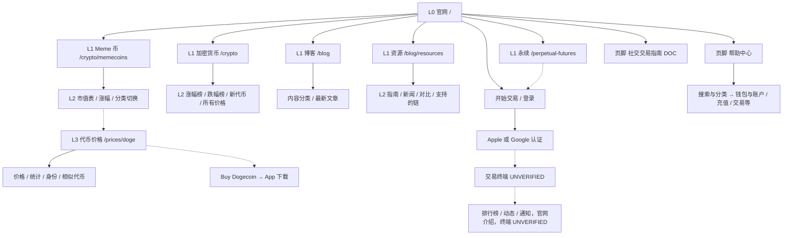
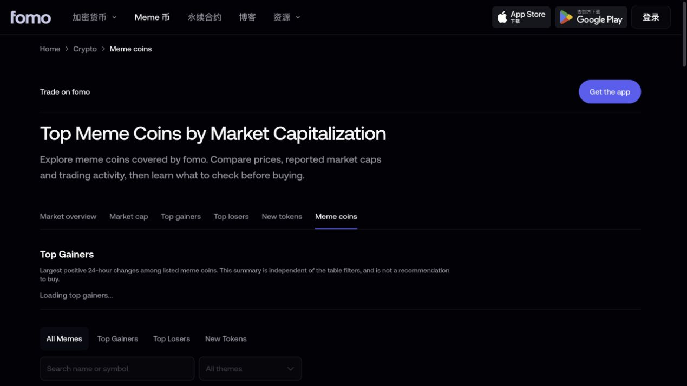

# FOMO · Desktop Web 产品架构

2026-11-19（曼谷时间）。游客官网顶部 5 个内容入口。登录后终端一级数量未知。

OBS 为实访页面与操作，DOC 为官网或帮助资料对终端行为的描述，INFER 为推断，UNVERIFIED 为未验证。

## A. 产品架构树

```text
FOMO
├── 官网
│   ├── 登录
│   ├── 开始交易
│   │   └── Apple、Google；下载应用
├── 加密货币
│   ├── 涨幅榜
│   ├── 跌幅榜
│   ├── 新代币
│   ├── 全部价格
├── Meme 币
│   ├── 市值表
│   │   └── 代币价格详情 > 购买弹窗、相似代币
├── 代币价格详情
├── 永续合约
├── 博客
├── 资源
│   ├── 指南
│   ├── 新闻
│   ├── 对比
│   ├── 支持的链
├── 帮助中心
│   ├── 分类目录
│   │   └── 账户钱包、充值提现、交易等
└── 终端内部 [UNVERIFIED]
```

## B. Sitemap

[Mermaid 源文件](sitemaps/04-fomo.mmd)。实线为导航或页内层级，虚线为上下文，点线指向的未验证目的地以文字标注。



## C. 导航分析

| 导航位置 | 功能入口 | 所属模块 | 页面层级 | 实际路径 |
| --- | --- | --- | --- | --- |
| 顶部及主按钮 | 官网 | 官网 | L1 | 开始交易 → 登录或创建账户 → Apple / Google，终端未进入 · [F01](screenshots/f01.jpg) [F03](screenshots/f03.jpg) |
| 顶部 | 加密货币 | 加密货币 | L1 | 官网顶部加密货币菜单 → 四个可见目的地，四个榜单均已实访 · [F04](screenshots/f04.jpg) [F09](screenshots/f09.jpg) [F10](screenshots/f10.jpg) [F11](screenshots/f11.jpg) [F12](screenshots/f12.jpg) [F13](screenshots/f13.jpg) |
| 顶部 | Meme 币 | Meme 币 | L1 | 首页 → Meme 币 → Dogecoin · [F05](screenshots/f05.jpg) [F06](screenshots/f06.jpg) |
| 上下文 | 代币价格详情 | 对象详情 | L2–L3 | Meme 币 → Dogecoin → Buy Dogecoin，弹出下载 App 二维码及应用商店入口 · [F06](screenshots/f06.jpg) [F07](screenshots/f07.jpg) |
| 顶部及页脚 | 永续合约 | 永续合约 | L1 | 首页 → 永续合约 → Start trading perps → Apple / Google 认证 · [F14](screenshots/f14.jpg) [F18](screenshots/f18.jpg) |
| 顶部及页脚 | 博客 | 博客 | L1 | 首页 → 博客 → 内容分类与最新文章 · [F15](screenshots/f15.jpg) |
| 顶部 | 资源 | 资源 | L1 | 顶部资源下拉目的地可见，资源聚合页已实访 · [F16](screenshots/f16.jpg) |
| 页脚 | 帮助中心 | 帮助中心 | L1 | 首页页脚帮助中心 URL → 简中帮助首页 · [F01](screenshots/f01.jpg) [F08](screenshots/f08.jpg) |
| 认证后 | 终端内部 | 终端内部 | L1 | 开始交易 → OAuth 弹窗，登录后路径未验证 · [F01](screenshots/f01.jpg) [F03](screenshots/f03.jpg) |

## D. 页面清单

| 页面名称 | 所属模块 | 页面用途 | 主要内容 | 关联页面 |
| --- | --- | --- | --- | --- |
| 官网 · `/` | 顶部及主按钮 | 品牌首页和交易入口 | 开始交易、登录、下载，首页介绍排行榜、动态和通知 | 开始交易 → 登录或创建账户 → Apple / Google，终端未进入 · OBS · [F01](screenshots/f01.jpg) [F03](screenshots/f03.jpg) |
| 加密货币 · `/crypto` | 顶部 | 公共市场分类入口 | 下拉列出涨幅榜 /top-movers、跌幅榜 /top-losers、新代币 /new、所有价格 /prices | 官网顶部加密货币菜单 → 四个可见目的地，四个榜单均已实访 · OBS · [F04](screenshots/f04.jpg) [F09](screenshots/f09.jpg) [F10](screenshots/f10.jpg) [F11](screenshots/f11.jpg) [F12](screenshots/f12.jpg) [F13](screenshots/f13.jpg) |
| Meme 币 · `/crypto/memecoins` | 顶部 | 按市值浏览 Meme 币 | 面包屑、市场分类切换、涨幅、代币表及 FAQ | 首页 → Meme 币 → Dogecoin · OBS · [F05](screenshots/f05.jpg) [F06](screenshots/f06.jpg) |
| 代币价格详情 · `/prices/doge` | 上下文 | 公开行情和代币科普 | 价格、市场统计、身份、相似代币及购买按钮 | Meme 币 → Dogecoin → Buy Dogecoin，弹出下载 App 二维码及应用商店入口 · OBS · [F06](screenshots/f06.jpg) [F07](screenshots/f07.jpg) |
| 永续合约 · `/perpetual-futures` | 顶部及页脚 | 公开内容入口 | 首页顶部与页脚重复入口，公开内容已实访 | 首页 → 永续合约 → Start trading perps → Apple / Google 认证 · OBS · [F14](screenshots/f14.jpg) [F18](screenshots/f18.jpg) |
| 博客 · `/blog` | 顶部及页脚 | 内容入口 | 公开导航和页脚链接，公开内容已实访 | 首页 → 博客 → 内容分类与最新文章 · OBS · [F15](screenshots/f15.jpg) |
| 资源 · `/blog/resources` | 顶部 | 指南和学习入口 | 可见指南、新闻、对比、支持的链链接 | 顶部资源下拉目的地可见，资源聚合页已实访 · OBS · [F16](screenshots/f16.jpg) |
| 帮助中心 · `https://help.fomo.family/zh-CN/` | 页脚 | 独立帮助中心 | 搜索和分类，包括账户钱包、充值、提现、交易、功能与永续 | 首页页脚帮助中心 URL → 简中帮助首页 · OBS · [F01](screenshots/f01.jpg) [F08](screenshots/f08.jpg) |
| 终端内部 · `登录后路由未验证` | 认证后 | 社交交易终端 | 排行榜、动态、通知是首页介绍（DOC）。交易者主页、账户、钱包和持仓导航均未知 | 开始交易 → OAuth 弹窗，登录后路径未验证 · UNVERIFIED · [F01](screenshots/f01.jpg) [F03](screenshots/f03.jpg) |

## E. 产品架构分析

公共站用顶部导航、菜单、面包屑和页脚组织市场及内容，没有观察到公共全局侧栏。Meme 列表同时提供分类和面包屑，浏览时较容易识别当前位置。官网主 CTA 与公开 Token 页的购买 CTA 实际去向不同，前者打开网页登录，后者打开 App 下载弹窗。对于想在电脑交易的用户，两条入口可能造成预期差。 [f03 f05 f06 f07]
首页把交易者排行榜、动态和通知放在同一段落中，体现社交定位（DOC）；桌面终端是否以同样优先级组织这些功能仍未验证。可借鉴公共行情页和产品内任务分层、真实面包屑以及明确的认证入口。应避免桌面行情上的购买按钮只露出 App 下载路径而缺少明确去向提示。
未验证登录后 Dashboard、Token 交易页、Holder、钱包分析、持仓、监控、策略、通知、社交深链和设置。公开站首页没有看到全局 Token 或钱包搜索，帮助站有文章搜索。工作台布局与上下文恢复未验证。

## F. 工作流与权限

| 路径 | 验证结果 | 证据 |
| --- | --- | --- |
| 市场总览 → 市值 / 涨幅 / 跌幅 / 新代币 | 四个公开榜单均可直接打开，并共享市场分类链接（OBS） | [总览](screenshots/f09.jpg) · [市值](screenshots/f13.jpg) · [涨幅](screenshots/f10.jpg) · [跌幅](screenshots/f11.jpg) · [新币](screenshots/f12.jpg) |
| Meme 币 → DOGE → Buy Dogecoin | 行情详情可读，购买按钮打开 App 下载弹窗（OBS） | [DOGE](screenshots/f06.jpg) · [下载弹窗](screenshots/f07.jpg) |
| 官网开始交易 / 永续 Start trading perps | 两条路径都打开 Apple / Google 登录或创建账户弹窗（OBS） | [官网认证](screenshots/f03.jpg) · [永续认证](screenshots/f18.jpg) |
| 社交动态 / 排行榜 / 通知 → Token 或交易者 | 官方指南介绍动态、榜单、通知三类功能（DOC）。终端中的落点和导航未验证 | [官方指南页面](screenshots/f17.jpg) |
| Token → Holder → 钱包 → 建立追踪 | 未验证。公开价格详情的实查范围是行情和币种信息 | [DOGE](screenshots/f06.jpg) |

| 身份 | 验证状态 |
| --- | --- |
| 游客 | 公开市场、价格、永续介绍、博客、资源和帮助均可见 |
| 已注册 / 已登录 | 缺少可用的既有会话，终端未验证 |
| 已连接钱包 | 未验证 |
| 免费 / 付费 | 未验证 |


游客可浏览公开市场、Token 价格与帮助。登录弹窗要求 Apple 或 Google，创建账户同时涉及成年确认和条款。未完成认证，注册、钱包连接、登录后的免费与付费身份均未验证。

## G. 证据读图

- FOMO · 官网 · `/` · OBS。开始交易 → 登录或创建账户 → Apple / Google，终端未进入。[F01](screenshots/f01.jpg) [F03](screenshots/f03.jpg)
- FOMO · 加密货币 · `/crypto` · OBS。官网顶部加密货币菜单 → 四个可见目的地，四个榜单均已实访。[F04](screenshots/f04.jpg) [F09](screenshots/f09.jpg) [F10](screenshots/f10.jpg) [F11](screenshots/f11.jpg) [F12](screenshots/f12.jpg) [F13](screenshots/f13.jpg)
- FOMO · Meme 币 · `/crypto/memecoins` · OBS。首页 → Meme 币 → Dogecoin。[F05](screenshots/f05.jpg) [F06](screenshots/f06.jpg)
- FOMO · 代币价格详情 · `/prices/doge` · OBS。Meme 币 → Dogecoin → Buy Dogecoin，弹出下载 App 二维码及应用商店入口。[F06](screenshots/f06.jpg) [F07](screenshots/f07.jpg)
- FOMO · 永续合约 · `/perpetual-futures` · OBS。首页 → 永续合约 → Start trading perps → Apple / Google 认证。[F14](screenshots/f14.jpg) [F18](screenshots/f18.jpg)
- FOMO · 博客 · `/blog` · OBS。首页 → 博客 → 内容分类与最新文章。[F15](screenshots/f15.jpg)
- FOMO · 资源 · `/blog/resources` · OBS。顶部资源下拉目的地可见，资源聚合页已实访。[F16](screenshots/f16.jpg)
- FOMO · 帮助中心 · `https://help.fomo.family/zh-CN/` · OBS。首页页脚帮助中心 URL → 简中帮助首页。[F01](screenshots/f01.jpg) [F08](screenshots/f08.jpg)
- FOMO · 终端内部 · `登录后路由未验证` · UNVERIFIED。开始交易 → OAuth 弹窗，登录后路径未验证。[F01](screenshots/f01.jpg) [F03](screenshots/f03.jpg)


